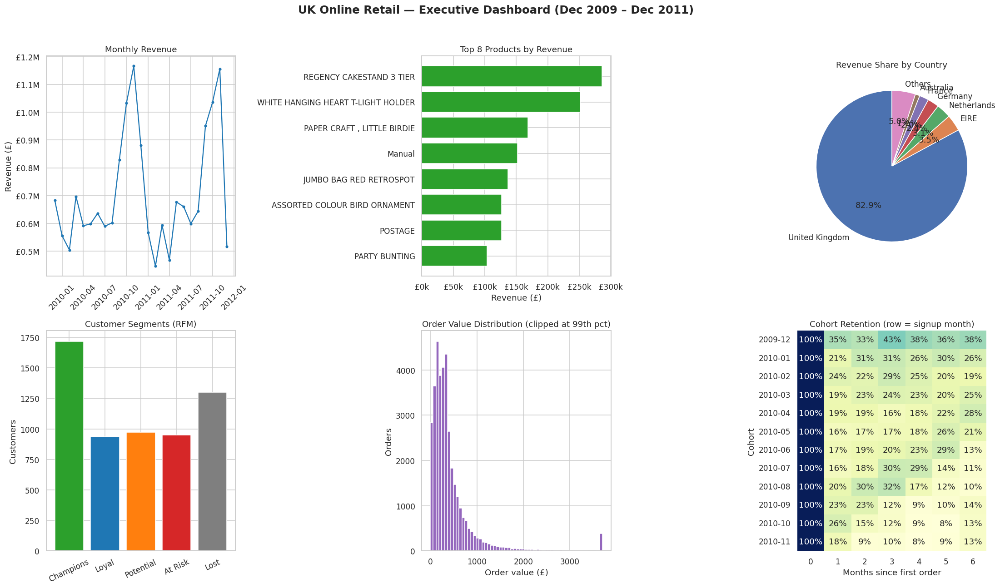

# UK Online Retail Analytics

End-to-end data analysis of **1,067,371 real e-commerce transactions** from a UK-based online gift retailer (Dec 2009 – Dec 2011), answering: *which customers is this business actually built on, and where is the growth leaking?*

**Dataset:** [UCI Online Retail II](https://archive.ics.uci.edu/dataset/502/online+retail+ii) (CC BY 4.0) — one row per product line per invoice. Not committed to this repo; download it with:

```bash
curl -L -o data/online_retail_II.xlsx "https://archive.ics.uci.edu/static/public/502/online+retail+ii.zip"
```

## Pipeline

`analyze.py` runs the full pipeline: load → clean → feature engineering → analysis → dashboard → findings.

**Cleaning audit (all numbers real):**
| Step | Rows removed / separated |
|---|---|
| Raw rows | 1,067,371 |
| No Customer ID (unusable for customer analysis) | 243,007 |
| Exact duplicates | 11,996 |
| Cancelled/return invoices (kept separate for returns analysis) | 18,688 |
| Non-positive quantity/price | 71 |
| **Clean sales rows** | **793,609** |

## Key findings

- **£17.69M total revenue** across 36,969 orders from 5,878 customers in 41 countries. Average order value £478, median £305.
- **Extreme customer concentration:** 1,719 "Champion" customers (29% of the base) drive **£14.26M — 80.6% of all revenue** (RFM segmentation).
- **Retention problem:** average month-1 cohort retention is just **21.2%**; 1,301 customers are classified "Lost".
- **Geographic concentration risk:** the UK is **82.9%** of revenue (£14.67M); next is EIRE at £0.62M.
- **Seasonality:** November 2010 peaked at **£1.17M** — Q4 holiday spikes are the revenue engine.
- **Returns:** 18,688 cancelled/return rows worth **£1.09M** (2.3% of rows).
- **Hero products:** Regency Cakestand 3 Tier (£286k), White Hanging Heart T-Light Holder (£252k), Paper Craft Little Birdie (£168k).



## What's in here

| File | What it is |
|---|---|
| `analyze.py` | Full pipeline — cleaning, RFM, cohorts, dashboard |
| `dashboard.png` | 6-panel executive dashboard |
| `findings.json` | All computed metrics in machine-readable form |
| `data/` | Raw dataset (download separately, see above) |

## Business recommendations

1. **Protect the Champions** — 29% of customers carry 80% of revenue; a loyalty/win-back program for this segment has the highest ROI.
2. **Fix month-1 retention** — 21% is the leak; a post-first-purchase email/coupon flow targets it directly.
3. **De-risk geography** — EIRE, Netherlands, Germany are the next-best markets; test localized campaigns there.
4. **Stock for Q4** — November is the peak; inventory and staffing should ramp from September.

## Tools

Python · pandas · NumPy · Matplotlib · Seaborn · openpyxl
